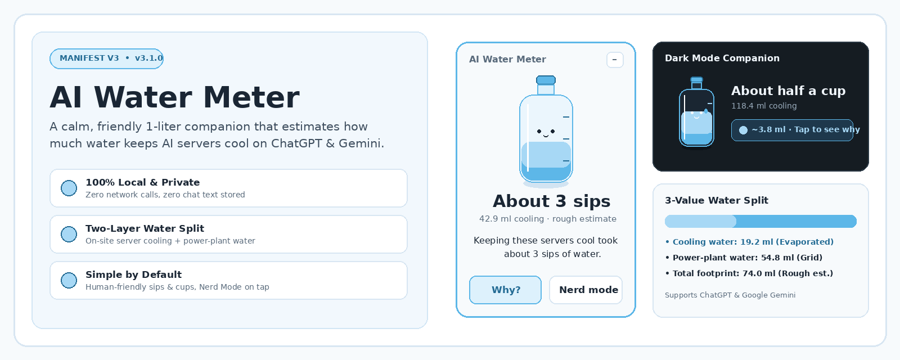
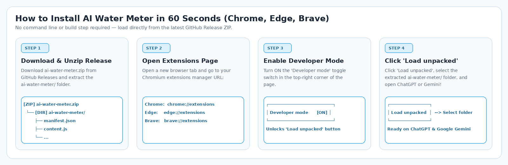
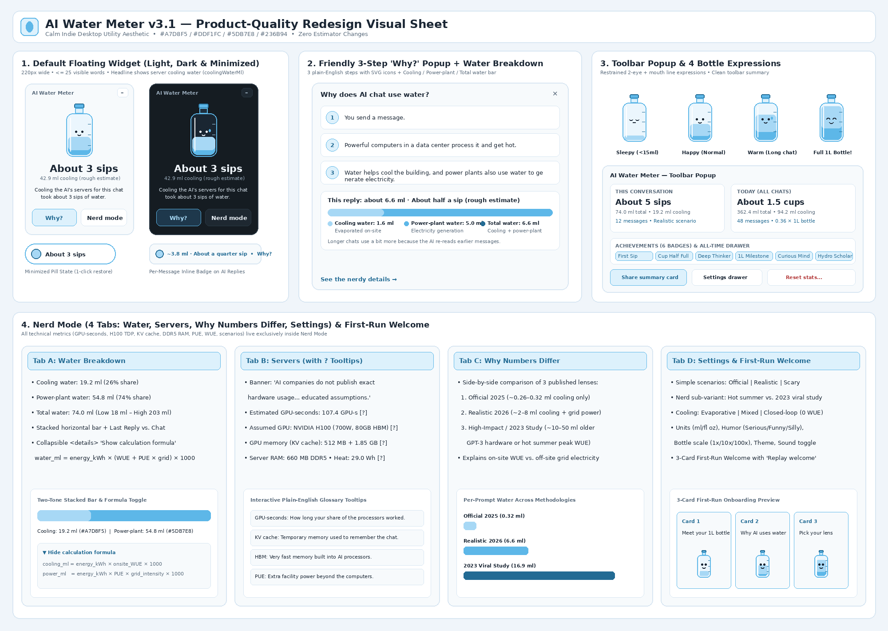

<div align="center">

# 💧 AI Water Meter

**A calm, friendly 1-liter companion that estimates how much water keeps AI servers cool on ChatGPT & Google Gemini.**

[](https://github.com/ziadkarem00/ai-water-meter/releases)
[](https://developer.chrome.com/docs/extensions/develop/migrate/what-is-mv3)
[](#8-privacy--security-guarantees)
[-F59E0B?style=for-the-badge)](#9-repository-structure--architecture)

[**⬇ Download Latest Release (`ai-water-meter.zip`)**](https://github.com/ziadkarem00/ai-water-meter/releases/latest) · [**How to Install (60s)**](#2-how-to-download--install-step-by-step-user-guide) · [**How It Works**](#5-how-the-water--hardware-estimates-work) · [**Interactive Preview**](preview/ai_water_meter_preview.html)



</div>

---

## 1. What Is AI Water Meter?

Every time you send a prompt to an AI assistant, high-density graphics processors (GPUs) in a data center consume electricity and convert almost all of that electrical energy into **heat**. To keep those servers within safe operating temperatures, data-center cooling systems reject heat—often evaporating clean water in cooling towers—while power stations also consume water upstream to generate the electricity itself.

**AI Water Meter** brings that hidden infrastructure to life right inside **ChatGPT** (`chatgpt.com`, `chat.openai.com`) and **Google Gemini** (`gemini.google.com`) with a crafted indie-utility aesthetic:

- **Signature 1-Liter Baby-Blue Bottle:** Gradually fills up as your conversation grows, featuring a two-layer water split (light baby blue `#A7D8F5` for **on-site server cooling water** above deeper sky blue `#5DB7E8` for **off-site power-plant water**) and a subtle 4-mood expression (*Sleepy*, *Happy*, *Warm/Sweating*, and *Celebrating* when you fill a full 1L bottle).
- **5-Second Human Perspective:** Translates small milliliter figures into everyday equivalents (*"About 5 drops"*, *"About 3 sips"*, *"About half a cup"*, *"About 2 bottles"*) right above the exact milliliter estimate (*"42.9 ml cooling · rough estimate"*).
- **Simple by Default, Deep on Tap:** Shows a calm, compact `220px` companion card (`<= 25` words) by default. One click opens a **3-Step Friendly "Why?" Popup** or a **4-Tab Nerd Mode** with full server hardware telemetry (`GPU-seconds`, `NVIDIA H100` power assumptions, `KV cache` memory growth, `PUE`, and `WUE`).
- **Honest Awareness Framing:** AI providers do not publish real-time per-prompt telemetry. Every number in AI Water Meter is clearly labeled as a **rough estimate** for education and awareness.

---

## 2. How to Download & Install (Step-by-Step User Guide)

You can install **AI Water Meter** in **Google Chrome**, **Microsoft Edge**, **Brave**, **Arc**, or **Opera** in under 60 seconds—no coding, terminal, or build tools needed.



### Option A: Quick Install from GitHub Releases (Recommended for Users)
1. **Download the ZIP:** Go to the [**Releases page**](https://github.com/ziadkarem00/ai-water-meter/releases/latest) and click **`ai-water-meter.zip`** under **Assets** to download it.
2. **Unzip the Archive:** Right-click `ai-water-meter.zip` and extract it to a permanent folder on your computer (for example, `Documents/ai-water-meter`). Inside, you will see the `ai-water-meter` folder containing `manifest.json`.
3. **Open Your Browser's Extensions Page:**
   - **Google Chrome:** Type `chrome://extensions` in the address bar and press **Enter**.
   - **Microsoft Edge:** Type `edge://extensions` in the address bar and press **Enter**.
   - **Brave Browser:** Type `brave://extensions` in the address bar and press **Enter**.
4. **Enable Developer Mode:** Toggle the **Developer mode** switch **ON** (top-right corner in Chrome/Brave, or left sidebar in Edge).
5. **Load Unpacked:** Click the **Load unpacked** button (top-left), select the extracted **`ai-water-meter`** folder (the folder that directly contains `manifest.json`), and click **Select Folder**.
6. **Start Chatting:** Open [ChatGPT](https://chatgpt.com/) or [Google Gemini](https://gemini.google.com/)! Your baby-blue 1L bottle companion will appear in the bottom-right corner above the message box.

### Option B: Clone via Git (For Developers)
```bash
git clone https://github.com/ziadkarem00/ai-water-meter.git
cd ai-water-meter
# Run the automated verification test suite (10/10 checks)
node tests/run_tests.js
```
Then load the repository root folder via `chrome://extensions` → **Load unpacked**.

---

## 3. Complete Visual Tour & Interface Guide



### A. The Default Floating Companion Widget
- **Headline Focuses on Server Cooling Water:** The main friendly number on the default widget specifically reflects **on-site server cooling water** (`coolingWaterMl`) so total footprint is never misrepresented as cooling-only water.
- **Draggable & Composer-Aware:** Drag the top header anywhere on the screen. Your custom position is saved locally, automatically clamps inside viewport bounds when you resize the window, and stays clear of the ChatGPT/Gemini prompt input box.
- **One-Click Minimize:** Click the `–` button to collapse the widget into a tiny floating pill (`💧 About 3 sips`). Click the pill anytime to expand it back.

### B. Per-Message Water Pill
- Beneath every completed AI reply on ChatGPT and Gemini, a subtle baby-blue pill displays an inline SVG water drop and the estimated water for that specific reply (e.g., `💧 ~3.8 ml · About a quarter sip`).
- Hovering shows *"Tap to see why."*; clicking opens the **Friendly "Why?" Popup** pre-loaded with that exact reply's breakdown.

### C. The Friendly 3-Step "Why?" Popup
Designed to be read in 10 seconds with zero technical jargon:
1. **Step 1:** *You send a message.*
2. **Step 2:** *Powerful computers in a data center process it and get hot.*
3. **Step 3:** *Water helps cool the building, and power plants also use water to generate electricity.*
- **3-Value Water Breakdown & Stacked Bar:** Clearly separates **Cooling water** (`#A7D8F5`), **Power-plant water** (`#5DB7E8`), and **Total water**, with display-layer rounding reconciliation so `Cooling + Power-plant = Total` always holds.
- **Long-Chat Context Notice:** Automatically notes when a long conversation increases energy and water usage because the model re-reads earlier messages.

### D. Nerd Mode (4-Tab Technical Drawer)
Click **`Nerd mode`** on the widget or **`See the nerdy details →`** inside the Why popup to open the full technical modal (`Escape` or `✕` to close, Left/Right arrow keys to switch tabs):
- **Tab 1 — Water:** Full split between Last Reply and Entire Chat, Low/Typical/High range, active cooling and scenario parameters, and a collapsible `<details>` block showing the exact mathematical formula.
- **Tab 2 — Servers:** Displays **10 hardware & token metrics** (*Estimated GPU-seconds*, *Assumed GPU type: NVIDIA H100 80GB HBM3 @ 700W*, *PUE*, *KV cache memory in MB*, *Server DDR5 RAM*, *Thermal heat in Wh & Joules*, *Input/Output tokens*, *Model multiplier*, and *Context growth factor*) with interactive `?` plain-English tooltips and an explicit assumption disclaimer.
- **Tab 3 — Why Numbers Differ:** Plain-English comparison explaining why published figures vary from `~0.26 mL` to `16.9+ mL` per prompt (new vs. 2023 hardware, on-site cooling vs. total grid footprint, climate/season, evaporative vs. closed-loop liquid cooling).
- **Tab 4 — Settings:** Switch between **Official numbers**, **Realistic** (default), and **Scary numbers** (with a sub-selector inside Nerd Mode distinguishing **Hot summer data center** vs. **Older 2023 viral study**), plus **Cooling system type** (*Evaporative*, *Mixed*, *Closed-loop liquid*), **Units** (`ml / L` or `fl oz / cups`), **Humor level** (*Serious*, *Funny*, *Extra silly*), **Bottle scale** (`1×`, `10×`, `100×`), **Theme** (*Auto*, *Light*, *Dark*), **Soft splash sound** (*OFF* by default), and **Replay welcome intro**.

### E. Browser Toolbar Popup, Achievements & Share Card
Click the **AI Water Meter** droplet icon in your browser toolbar to see:
- **Today's Water Summary & Active Conversation Summary** with a visual mini-bottle counter.
- **6 Local Achievement Badges:** *First Drop*, *Chatty Fish*, *Deep Thinker*, *Bottle Filler*, *Curious Mind*, and *Hydro Scholar*—unlocked purely from local numerical counters.
- **Local PNG Share Card Generator:** Exports a crisp `1200×630` PNG summary card rendered locally via HTML5 `<canvas>` with zero external uploads.
- **Expandable All-Time Statistics & Settings Drawer** with a two-step **Reset Statistics** confirmation.

---

## 4. Scientific Benchmarks & Estimation Methodology

All calculations live in `config.js` and `estimator.js`. Because AI companies do not expose real-time per-prompt server telemetry, AI Water Meter models energy and water using peer-reviewed academic frameworks and official environmental disclosures:

```text
total_energy_kWh   = server_energy_kWh × PUE
cooling_water_ml   = server_energy_kWh × onsite_WUE_L_per_kWh × 1000
powerplant_water_ml= total_energy_kWh  × offsite_grid_L_per_kWh × 1000
total_water_ml     = cooling_water_ml  + powerplant_water_ml
```

| Scenario Lens | Base Server Energy (Medium Reply) | PUE | On-Site Cooling WUE | Off-Site Grid Water | Typical Medium Prompt Result | Primary Source / Benchmark |
| :--- | :--- | :--- | :--- | :--- | :--- | :--- |
| **1. Official Numbers** (`official_2025`) | `0.24 Wh` | `1.10` | `1.15 L/kWh` | `0.00 L/kWh` *(on-site only)* | **~0.28 mL** *(~5 drops)* | [Google Cloud Blog (Aug 2025)](https://cloud.google.com/blog/products/infrastructure/measuring-the-environmental-impact-of-ai-inference) (`0.24 Wh`, `0.26 mL`) & [OpenAI / Sam Altman (Jun 2025)](https://towardsdatascience.com/lets-analyze-openais-claims-about-chatgpt-energy-use/) (`0.34 Wh`, `~0.32 mL`) |
| **2. Realistic (Default)** (`realistic_full`) | `1.10 Wh` | `1.16` | `1.45 L/kWh` | `3.90 L/kWh` | **~6.6 mL** *(1.6 mL cooling + 5.0 mL grid)* | Full-chain model combining on-site evaporative cooling with US average thermoelectric grid water intensity ([LBNL / TechTarget](https://www.techtarget.com/news/A-shadow-water-problem-AIs-power-demand-shifts-consumption-upstream/856955/)) |
| **3A. Scary — Hot Summer** (`hot_climate`) | `2.60 Wh` | `1.25` | `2.60 L/kWh` | `4.52 L/kWh` | **~21.5 mL** *(6.8 mL cooling + 14.7 mL grid)* | Peak summer cooling demand (`WUE > 2.2 L/kWh`) on water-intensive regional grids ([GreenCalculus](https://greencalculus.com/data/ai-water-usage/), [ModulEdge](https://www.moduledge.com/blog/ai-water-usage)) |
| **3B. Scary — 2023 Viral Study** (`viral_2023`) | `4.00 Wh` | `1.17` | `0.55 L/kWh` | `3.14 L/kWh` | **~16.9 mL** *(~30 replies per 500 mL bottle)* | [Li et al., UC Riverside (arXiv:2304.03271)](https://arxiv.org/abs/2304.03271) & [UC Riverside News](https://news.ucr.edu/articles/2023/04/28/ai-programs-consume-large-volumes-scarce-water) |

### Hardware & Context-Length Assumptions (Nerd Mode → Servers Tab)
- **GPU Node Baseline:** Modeled on an 8-GPU [NVIDIA H100 SXM5](https://www.nvidia.com/en-us/data-center/h100/) HGX node (`700 W` TDP per GPU, `80 GB` HBM3 memory, [MorphLLM](https://www.morphllm.com/nvidia-h100)).
- **KV-Cache Memory Scaling:** Uses `0.32 MB per token` of active context in HBM3 (`320 KB/token` for 70B-class GQA models in BF16; [Prompt20 KV Cache Math](https://blog.prompt20.com/posts/kv-cache/), [AWS KV Cache Tiering Blog](https://aws.amazon.com/blogs/storage/accelerate-inference-with-kv-cache-tiering-on-aws/), [GigaGPU](https://gigagpu.com/kv-cache-explained-vram/)).
- **Closed-Loop Cooling Option:** Selecting **Closed-loop liquid cooling** sets on-site evaporative `WUE = 0.00 L/kWh`, reflecting next-generation zero-evaporation data centers ([Microsoft Cloud Blog](https://www.microsoft.com/en-us/microsoft-cloud/blog/2024/12/09/sustainable-by-design-next-generation-datacenters-consume-zero-water-for-cooling/), [Introl](https://introl.com/blog/water-usage-efficiency-wue-ai-data-center-cooling-guide-2025)).
- **Reasoning / Thinking Multiplier:** Applies a `2.5×` multiplier when reasoning indicators (`Thought for...`, `Show thinking`) are detected ([Epoch AI](https://epoch.ai/gradient-updates/how-much-energy-does-chatgpt-use), [arXiv:2505.09598](https://arxiv.org/html/2505.09598v5)).

---

## 5. Privacy & Security Guarantees

- **Zero Text Storage:** AI Water Meter **never stores, logs, or transmits** your prompts or AI responses. DOM text is measured transiently (`text.trim().length`) solely to estimate token count and immediately discarded.
- **Zero Network Calls:** No analytics, no telemetry servers, no external fonts, and no remote scripts or images.
- **Minimal Permissions:** Requests only `"storage"` (`chrome.storage.local`) and runs exclusively on `https://chatgpt.com/*`, `https://chat.openai.com/*`, and `https://gemini.google.com/*`.

---

## 6. Repository Structure & Updating Selectors

```text
ai-water-meter/
├── manifest.json                         # Chrome/Edge Manifest V3 configuration
├── config.js                             # Scenarios, cooling types, hardware constants & palettes
├── selectors.js                          # Centralized ChatGPT & Gemini DOM selectors + fallbacks
├── estimator.js                          # Pure estimation engine & human-scale formatters
├── comparisons.js                        # Rotating comparisons across Serious / Funny / Silly modes
├── bottle.js                             # Inline SVG 1L bottle, icon set & Canvas PNG share card
├── content.js                            # Shadow DOM widget, Why popup, Nerd mode & observer
├── popup.html / popup.css / popup.js     # Browser toolbar popup & settings drawer
├── icons/                                # Extension icons (icon16.png, icon48.png, icon128.png)
├── screenshots/                          # Repository showcase images & installation guide
├── preview/ai_water_meter_preview.html   # Standalone interactive preview (all 12 UI surfaces)
└── tests/run_tests.js                    # Automated Node.js verification suite (10/10 checks)
```

- **Updating DOM Selectors (`selectors.js`):** If ChatGPT or Gemini updates its web interface, open `selectors.js` and add the new CSS selector at the top of `assistantMessages`, `userMessages`, or `composerBox` inside `SITE_SELECTORS.chatgpt` or `SITE_SELECTORS.gemini`.
- **Running Automated Tests:** Run `node tests/run_tests.js` to execute all 10 unit and layout verification suites.

---

## 7. Known Limitations

- **Approximate Educational Estimates:** All values are modeled approximations based on character-to-token heuristics (`~4 chars/token`) and published fleet averages, not hardware sensor readings from OpenAI or Google servers.
- **Hidden Reasoning Tokens:** When a reasoning model hides its internal chain-of-thought, the extension applies a fixed `2.5×` multiplier rather than counting unexposed reasoning tokens.

---

## 8. License

Released under the **MIT License**. Designed and engineered by **Ziad Karem Mahmoud** ([@ziadkarem00](https://github.com/ziadkarem00)).
